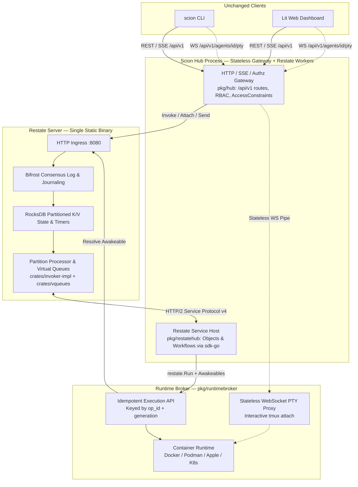

# Plan Argon Final: Restate-Native Scion Hub Architecture & Cutover Blueprint

## 1. Objective & Quantitative Scope

Replace Scion Hub’s relational database layer (SQLite, PostgreSQL, AlloyDB), Ent ORM codegen, custom distributed lease engines, SQL-backed work/timer queues, and WebSocket control-channel multiplexer with **Restate** (`restate-server` + `restate.dev/sdk-go`).

### Rules of Engagement
1. **Zero Client Breakage**: Preserve Scion’s existing `/api/v1` HTTP, SSE, and WebSocket (`scion attach` PTY) wire contracts so `cmd/` (`scion` CLI) and `web/` (Lit frontend) require zero architectural rewrite.
2. **Clean Alpha Cutover**: Per `AGENTS.md` (*"Alpha: changing or removing behavior needs no deprecation path"*), do not maintain a parallel SQL Hub, do not build relational-to-Restate data migration tools, do not add dual-write shims, and do not gate the persistence engine behind user-facing experiment flags.
3. **Codebase Reduction Target**: Directly eliminate **631,841+ lines of Go** (~20% of the repository) and **52,992 generated AST symbols**:

| Eliminated Subsystem | Repository Path | Files | Physical LOC | Replaced By |
| :--- | :--- | :--- | :--- | :--- |
| **Ent ORM Codegen & Schemas** | `pkg/ent/**` | 755 | 479,292 | Restate Virtual Object K/V state (`RocksDB` + `Bifrost` WAL) |
| **SQL Store & Adapters** | `pkg/store/**` | 381 | 135,370 | Scoped Virtual Objects & deterministic workflows in `pkg/restatehub` |
| **Custom Lease & Saga Engines** | `pkg/hub/agent_create_tx*.go`, `pkg/hub/agent_delete_engine*.go`, `pkg/hub/start_claim*.go`, `pkg/hub/admin_maintenance_run*.go` | 16 | 11,260 | `AgentObject` single-writer serialization + `AgentOpWorkflow` sagas |
| **Control Channel RPC Multiplexer** | `pkg/hub/controlchannel*.go`, `pkg/wsprotocol/**`, `pkg/wsclient/**` | 17 | 5,919 | Restate HTTP/2 Service Protocol v4 + `restate.Awakeable` |
| **Total Directly Eliminated** | | **1,169** | **631,841** | |

---

## 2. Target System Architecture



### Deployment Topologies
- **Workstation Combo Server (`scion server start`)**:
  - Explicitly starts and supervises `restate-server` on loopback (storing state in `~/.scion/restate/`), the stateless `/api/v1` gateway, the co-located `restate.dev/sdk-go` worker endpoint, the local Runtime Broker, and the Web UI.
  - Ordinary CLI commands (`scion list`, `scion start`, etc.) never start `restate-server` implicitly.
- **Hosted Deployment**:
  - Stateless Hub pods (running the `/api/v1` gateway and `pkg/restatehub` SDK handlers) sit alongside a `restate-server` StatefulSet/cluster, dispatching to remote Runtime Brokers.

---

## 3. The Six Iron Architectural Invariants

These invariants combine the concrete codebase mapping of `plan1.md` with the red-team distributed systems corrections of `plan2.md`:

### Invariant 1: Split Short Object Locks (`restate.Object`) from Long Sagas (`restate.Workflow`)
- **The Trap**: In Restate (`protocol.proto` `SuspensionMessage`), suspending inside an exclusive Virtual Object handler **holds the object lock** across the await point. Running a 5-minute container image pull inside `AgentObject.Create` would block `AgentObject.Stop` and `AgentObject.Delete` in Restate’s virtual queue (`crates/vqueues`).
- **The Rule**:
  - **Virtual Objects (`AgentObject`, `ProjectObject`, `QuotaObject`)** execute **only fast, non-blocking in-memory K/V transitions**. They never await container pulls, external webhooks, or long sleeps.
  - **Workflows (`AgentOpWorkflow[op_id]`)** execute all multi-step orchestration, broker RPCs, `restate.Awakeable` waits, and reverse saga compensations.
  - When `Delete` or `Stop` arrives on `AgentObject[agent_id]` while a launch is in flight, `AgentObject` immediately increments its `generation` counter, cancels the active `AgentOpWorkflow[op_id]` via `restate.CancelInvocation`, and starts the teardown workflow—zero head-of-line blocking.

### Invariant 2: Granular Keyed State (Zero $O(N^2)$ Array Rewrites)
- **The Trap**: Restate’s `SetStateCommandMessage` overwrites an entire `bytes value` for a `bytes key`. Storing `[]Message` or `map[string]AgentSummary` in a single key re-serializes the entire collection into the Bifrost WAL on every write.
- **The Rule**: Store collection items as individual prefixed keys inside their owning Virtual Object and enumerate them with `restate.Keys(ctx)` (`GetEagerStateKeysCommandMessage`):
  - `ProjectObject[project_id]`: keys `"meta"`, `"agent:<agent_id>"`, `"env:<key>"`, `"secret:<name>"`, `"member:<principal_id>"`.
  - `ConversationObject[conv_id]`: keys `"meta"`, `"msg:<08d_seq>"`, `"sub:<awakeable_id>"`.
  - `QuotaObject[scope_id]`: keys `"limits"`, `"res:<op_id>"`.

### Invariant 3: End-to-End Broker Idempotency & Generation Fencing
- **The Trap**: In `protocol.proto` (`ProposeRunCompletionMessage`), the SDK executes a `restate.Run` closure *before* the completion is journaled by `restate-server`. If the Broker starts a container and the network drops before `ProposeRunCompletionMessage` commits, Restate replays `restate.Run`.
- **The Rule**:
  - Every `AgentOpWorkflow` generates a deterministic `op_id` / `run_id` using `restate.UUID(ctx)` (seeded by `StartMessage.random_seed`) and carries the `AgentObject`'s monotonic `generation` integer.
  - Broker operations (`Provision`, `Run`, `Stop`, `Delete`) are idempotent on `(agent_id, run_id, generation)`:
    - If `Run` is retried with the same `run_id` and the container labeled `scion.run_id=<run_id>` already exists, the Broker returns the existing container ID instead of spawning a second container.
    - If a stale broker report or timer fires carrying `generation < current_generation`, `AgentObject` drops it as a no-op.

### Invariant 4: Envelope Encryption (`enc:v2:`) & Journal Secret Redaction
- **The Trap**: Restate persists all handler inputs, `restate.Run` outputs, and object state in RocksDB (`sys_journal` and `state`), which are inspectable via `restate invocations inspect` and Admin APIs.
- **The Rule**:
  - Secrets stored in `ProjectObject` or `HubSettingsObject` must always be encrypted via `pkg/secret` (`enc:v2:` ciphertexts) *before* being passed into any Restate handler or state key.
  - Workflows pass only secret references or `enc:v2:` ciphertexts in their journaled steps; plaintext decryption occurs only inside the ephemeral memory of the `restate.Run` dispatch closure that transmits the payload to the Broker over TLS/HMAC.

### Invariant 5: Keyed Index Objects Over DataFusion Table Scans
- **The Trap**: Restate’s DataFusion engine (`../restate/crates/storage-query-datafusion`) scans raw `bytes` blobs in `state` and `sys_journal` without secondary B-tree indexes.
- **The Rule**:
  - Serve all user-facing OLTP list/filter endpoints (`GET /api/v1/projects/{id}/agents`, `scion list`) from strongly consistent, partition-local keyed state on `ProjectObject[project_id]` and `GlobalRegistryObject["system"]`, filtered by Scion’s existing in-process RBAC kernel (`pkg/hub/authz`).
  - Reserve DataFusion SQL (`restate sql`) strictly for operator CLI debugging and offline support diagnostics.

### Invariant 6: Durable Event Streams vs. Ephemeral PTY Byte Pipes
- **The Rule**:
  - **Structured Events & Logs** (agent phase transitions, chat messages, tool calls, execution logs) flow through Restate Virtual Objects (`ConversationObject`, `AgentLogObject`) using cursor offsets and Awakeable fan-out, translated by the `/api/v1` gateway into the exact SSE/WebSocket frames existing clients expect.
  - **Interactive Terminal I/O** (`scion attach`, web terminal `tmux` keystrokes, window resizes) bypasses Restate completely and streams through a stateless WebSocket proxy (`pkg/hub` &rarr; `pkg/runtimebroker` &rarr; container PTY).

---

## 4. Complete Ownership Matrix (`pkg/store/store.go` &rarr; Restate)

Every sub-interface in `pkg/store/store.go` (4,862 lines) maps to a single authoritative Restate owner:

| Current `store.Store` Sub-Interface | Replaced Restate Owner | Keying Strategy | Granular State Keys & Notes |
| :--- | :--- | :--- | :--- |
| `AgentStore` + `AgentHoldStore` + `AgentCredentialStore` + `AgentIdentityKeyStore` + `AgentServiceAccountAssignmentStore` | **`AgentObject`** (`restate.Object`) + **`AgentOpWorkflow`** (`restate.Workflow`) | `agent_id` (Object) / `op_id` (Workflow) | `"info"`, `"gen"`, `"active_op"`, `"hold:<id>"`, `"cred"`, `"sa_assign"`, `"run:<seq>"`. Slug uniqueness enforced in `ProjectObject` via `"slug:<slug>"`. |
| `ProjectStore` + `ProjectProviderStore` + `ProjectSyncStateStore` + `EnvVarStore` + `SecretStore` + `SecretEncryptionStore` | **`ProjectObject`** (`restate.Object`) | `project_id` | `"meta"`, `"agent:<id>"`, `"slug:<slug>"`, `"broker:<id>"`, `"sync_state"`, `"env:<key>"`, `"secret:<name>"` (`enc:v2:` ciphertext). |
| `RuntimeBrokerStore` + `BrokerSecretStore` + `BrokerSettingStore` + `BrokerDispatchStore` | **`BrokerObject`** (`restate.Object`) | `broker_id` | `"reg"`, `"hmac_secret"` (`enc:v2:`), `"settings"`, `"task:<op_id>"` (Awakeable ID for pull/NAT brokers). |
| `QuotaStore` | **`QuotaObject`** (`restate.Object`) | `scope_id` (`project:<id>` or `broker:<id>`) | `"limits"`, `"res:<op_id>"` (idempotent reservation record holding `agent_id`, `amount`, `created_at`). |
| `TemplateStore` + `HarnessConfigStore` + `SkillStore` + `SkillRegistryStore` + `SkillInjectionStore` + `LifecycleHookStore` | **`CatalogObject`** (`restate.Object`) | `scope_id` (`global`, `project:<id>`, `user:<id>`) | `"tpl:<id>"`, `"hcfg:<id>"`, `"skill:<id>"`, `"skill_reg:<id>"`, `"skill_inj:<id>"`, `"hook:<id>"`. File blobs stay in `pkg/storage` (local fs / GCS). |
| `UserStore` + `ExternalIdentityStore` + `UserAccessTokenStore` + `UserTerminalWorkspaceStore` + `AllowListStore` + `InviteCodeStore` | **`IdentityObject`** (`restate.Object`) | `user_id` or `"directory"` | `IdentityObject[user_id]`: `"profile"`, `"uat:<id>"`, `"term_ws"`. `IdentityObject["directory"]`: `"ext:<prov>:<iss>:<sub>"`, `"email:<email>"`, `"allow:<email>"`, `"invite:<code>"`. |
| `GroupStore` + `RoleStore` + `AccessConstraintStore` + `DelegationEdgeStore` + `DelegationAdoptionStore` + `AgentDelegationStore` + `TestIdentityDelegationStore` + `MutationAuditStore` | **`AuthzObject`** (`restate.Object`) | `scope_id` (`system` or `project:<id>`) | `"group:<id>"`, `"role:<id>"`, `"bind:<id>"`, `"ac:<id>"`, `"edge:<id>"`, `"grant:<id>"`, `"audit:<seq>"`. |
| `MembershipLossCheckStore` | **Eliminated** | N/A | Replaced by direct async `restate.ObjectSend(ctx, "AgentObject", agentID, "EvaluateStanding").Send(...)` when `AuthzObject` or `ProjectObject` removes a member. |
| `ConversationStore` + `ThreadGroupStore` + `MessageStore` + `NotificationStore` | **`ConversationObject`** (`restate.Object`) | `conversation_id` | `"meta"`, `"part:<id>"`, `"msg:<08d_seq>"`, `"sub:<id>"`, `"waiter:<awakeable_id>"`. |
| `ScheduledEventStore` + `ScheduleStore` | **`SchedulerObject`** (`restate.Object`) | `schedule_id` | `"spec"`, `"next_seq"`. Uses `restate.ObjectSend(...).Send(..., restate.WithDelay(d))` for durable one-shot and recurring timers with generation checks. |
| `HubSettingStore` + `AgentSessionMetricsStore` + `GCPServiceAccountStore` + `GitHubInstallationStore` | **`HubStateObject`** (`restate.Object`) | `"global"` | `"setting:<section>"`, `"revision"`, `"gcp_sa:<id>"`, `"gh_install:<id>"`, `"metrics:<agent_id>"`. |
| `MaintenanceStore` | **`MaintenanceWorkflow`** (`restate.Workflow`) | `run_id` | Durable execution of admin maintenance tasks; panic/cancellation cleanup via native `defer`. |

---

## 5. Concrete Go SDK Implementation Blueprints

### 5.1 Separating Fast `AgentObject` Mutations from `AgentOpWorkflow` Sagas

```go
// pkg/restatehub/agent_object.go
type AgentObject struct{}

type ClaimOpRequest struct {
    OpID       string      `json:"opId"`
    OpKind     string      `json:"opKind"` // "create", "start", "stop", "delete"
    Preempt    bool        `json:"preempt"`
    Spec       *AgentSpec  `json:"spec,omitempty"`
}

type ClaimOpResponse struct {
    Generation        uint64 `json:"generation"`
    CancelledWorkflow string `json:"cancelledWorkflow,omitempty"`
}

// ClaimOp is a fast, non-blocking exclusive handler (<1ms). It never performs external I/O.
func (AgentObject) ClaimOp(ctx restate.ObjectContext, req ClaimOpRequest) (ClaimOpResponse, error) {
    gen, _ := restate.Get[uint64](ctx, "gen")
    activeOp, _ := restate.Get[ActiveOp](ctx, "active_op")

    if activeOp.OpID != "" && activeOp.OpID != req.OpID {
        if !req.Preempt {
            return ClaimOpResponse{}, restate.TerminalErrorf("conflict: operation %s (%s) already in progress", activeOp.OpKind, activeOp.OpID)
        }
        // Preempt in-flight operation (e.g. Delete arriving while Create/Start is waiting on Broker)
        restate.CancelInvocation(ctx, activeOp.WorkflowInvocationID)
    }

    gen++
    restate.Set(ctx, "gen", gen)
    
    // Start the asynchronous workflow that will execute the actual saga
    wfHandle := restate.WorkflowSend(ctx, "AgentOpWorkflow", req.OpID, "Run").Send(WorkflowInput{
        AgentID:    restate.Key(ctx),
        OpID:       req.OpID,
        OpKind:     req.OpKind,
        Generation: gen,
        Spec:       req.Spec,
    })
    invID, err := wfHandle.GetInvocationId()
    if err != nil {
        return ClaimOpResponse{}, err
    }

    restate.Set(ctx, "active_op", ActiveOp{
        OpID:                 req.OpID,
        OpKind:               req.OpKind,
        Generation:           gen,
        WorkflowInvocationID: invID,
    })

    return ClaimOpResponse{Generation: gen, CancelledWorkflow: activeOp.WorkflowInvocationID}, nil
}
```

### 5.2 Deterministic Provisioning Saga (`AgentOpWorkflow`)

```go
// pkg/restatehub/agent_op_workflow.go
type AgentOpWorkflow struct {
    brokerClient BrokerClient
}

func (w *AgentOpWorkflow) Run(ctx restate.WorkflowContext, in WorkflowInput) (err error) {
    var compensations []func() error
    defer func() {
        if err != nil {
            for _, comp := range slices.Backward(compensations) {
                _ = comp()
            }
            _, _ = restate.Object[restate.Void](ctx, "AgentObject", in.AgentID, "FailOp").
                Request(FailOpRequest{OpID: in.OpID, Generation: in.Generation, Reason: err.Error()})
        }
    }()

    // Step 1: Claim slug in ProjectObject (Idempotent on AgentID)
    compensations = append(compensations, func() error {
        _, cErr := restate.Object[restate.Void](ctx, "ProjectObject", in.Spec.ProjectID, "ReleaseSlug").
            Request(SlugClaim{Slug: in.Spec.Slug, AgentID: in.AgentID})
        return cErr
    })
    if _, err = restate.Object[restate.Void](ctx, "ProjectObject", in.Spec.ProjectID, "ClaimSlug").
        Request(SlugClaim{Slug: in.Spec.Slug, AgentID: in.AgentID}); err != nil {
        return err
    }

    // Step 2: Reserve Broker Quota (Idempotent on OpID)
    compensations = append(compensations, func() error {
        _, cErr := restate.Object[restate.Void](ctx, "QuotaObject", "broker:"+in.Spec.BrokerID, "Release").
            Request(QuotaRelease{OpID: in.OpID})
        return cErr
    })
    if _, err = restate.Object[restate.Void](ctx, "QuotaObject", "broker:"+in.Spec.BrokerID, "Reserve").
        Request(QuotaReserve{OpID: in.OpID, AgentID: in.AgentID, Amount: 1}); err != nil {
        return err
    }

    // Step 3: Dispatch Provision & Launch to Broker with deterministic RunID + Awakeable
    launchAwakeable := restate.Awakeable[BrokerLaunchResult](ctx)
    compensations = append(compensations, func() error {
        _, cErr := restate.Run(ctx, func(rctx restate.RunContext) (restate.Void, error) {
            return restate.Void{}, w.brokerClient.DeleteContainerIdempotent(rctx, in.Spec.BrokerID, in.AgentID, in.OpID)
        }, restate.WithName("Compensate: broker delete container"))
        return cErr
    })

    if _, err = restate.Run(ctx, func(rctx restate.RunContext) (restate.Void, error) {
        return restate.Void{}, w.brokerClient.StartContainerIdempotent(rctx, BrokerStartCmd{
            AgentID:     in.AgentID,
            RunID:       in.OpID,
            Generation:  in.Generation,
            AwakeableID: launchAwakeable.Id(),
            Spec:        in.Spec, // Secrets remain enc:v2: until decrypted inside this RunContext
        })
    }, restate.WithName("Dispatch broker start")); err != nil {
        return err
    }

    // Step 4: Race Awakeable completion against LaunchTimeout
    timeoutFuture := restate.After(ctx, in.Spec.LaunchTimeout)
    first, err := restate.WaitFirst(ctx, launchAwakeable, timeoutFuture)
    if err != nil {
        return err
    }
    if first == timeoutFuture {
        return restate.TerminalErrorf("launch timed out after %v", in.Spec.LaunchTimeout)
    }
    launchRes, err := launchAwakeable.Result()
    if err != nil {
        return err
    }

    // Step 5: Commit Running State on AgentObject (Fenced by Generation)
    _, err = restate.Object[restate.Void](ctx, "AgentObject", in.AgentID, "CommitLaunch").
        Request(CommitLaunchRequest{
            OpID:        in.OpID,
            Generation:  in.Generation,
            ContainerID: launchRes.ContainerID,
        })
    return err
}
```

### 5.3 Granular Message Storage & SSE Fan-Out (`ConversationObject`)

```go
// pkg/restatehub/conversation_object.go
type ConversationObject struct{}

func (ConversationObject) AppendMessage(ctx restate.ObjectContext, msg Message) (uint64, error) {
    seq, _ := restate.Get[uint64](ctx, "next_seq")
    seq++
    restate.Set(ctx, "next_seq", seq)
    msg.Seq = seq

    // O(1) granular key write — never rewrites historical messages
    msgKey := fmt.Sprintf("msg:%08d", seq)
    restate.Set(ctx, msgKey, msg)

    // Wake any long-polling SSE gateway readers waiting for new messages
    keys, _ := restate.Keys(ctx)
    for _, k := range keys {
        if strings.HasPrefix(k, "waiter:") {
            awkID := strings.TrimPrefix(k, "waiter:")
            restate.ResolveAwakeable(ctx, awkID, msg)
            restate.Clear(ctx, k)
        }
    }
    return seq, nil
}
```

---

## 6. Phased Execution Plan

### Phase 1: Restate Supervision & SDK Host (`pkg/restatehub`)
- **Work**:
  1. Add `github.com/restatedev/sdk-go` to `go.mod`.
  2. Implement `pkg/restatehub/supervisor.go` to manage the `restate-server` child process during `scion server start` (workstation data dir `~/.scion/restate/`, explicit startup/shutdown lifecycle, health polling, and automatic service deployment registration).
  3. Create `pkg/restatehub/host.go` binding the core Restate services (`AgentObject`, `AgentOpWorkflow`, `ProjectObject`, `BrokerObject`, `QuotaObject`, `CatalogObject`, `IdentityObject`, `AuthzObject`, `ConversationObject`, `SchedulerObject`, `HubStateObject`, `MaintenanceWorkflow`).
- **Acceptance**:
  - `scion server start` starts `restate-server`, registers all `pkg/restatehub` services, and passes readiness checks without initializing SQLite or PostgreSQL.

### Phase 2: Vertical Lifecycle Slice (`ProjectObject`, `AgentObject`, `QuotaObject`, `AgentOpWorkflow`)
- **Work**:
  1. Implement `ProjectObject`, `QuotaObject`, `AgentObject`, and `AgentOpWorkflow` following the 6 Iron Invariants.
  2. Update `pkg/runtimebroker` to accept deterministic `run_id` / `op_id` and `generation` fencing tokens, reconcile existing containers on retry, and resolve `AwakeableID` on launch completion.
  3. Wire `/api/v1/projects` and `/api/v1/projects/{projectId}/agents` handlers in `pkg/hub` to call `pkg/restatehub` via the Restate ingress client.
- **Acceptance**:
  - Unchanged `scion` CLI executes `scion project init`, `scion start`, `scion list`, `scion stop`, and `scion delete` end-to-end against Restate.
  - Fault-injection tests verify:
    - Crash between Broker container launch and `ProposeRunCompletionMessage` reconciles the container without creating a duplicate.
    - `scion delete` issued while `AgentOpWorkflow` is blocked waiting on an Awakeable preempts the workflow immediately, runs reverse compensations, releases quota, and deletes the container.

### Phase 3: Authz, Identities, Catalogs, & Secrets (`IdentityObject`, `AuthzObject`, `CatalogObject`)
- **Work**:
  1. Migrate Users, UATs, Groups, RoleBindings, AccessConstraints, DelegationEdges, and AgentDelegations into `IdentityObject` and `AuthzObject`.
  2. Replace `MembershipLossCheckStore` polling (`pkg/hub/membership_loss.go`) with immediate `restate.ObjectSend` calls to affected `AgentObject` instances upon member removal.
  3. Migrate Templates, HarnessConfigs, Skills, and LifecycleHooks metadata into `CatalogObject` (keeping file blobs in `pkg/storage`).
  4. Verify `pkg/secret` `enc:v2:` envelope encryption across all secret writes and workflow inputs so zero plaintext secret values appear in `restate invocations inspect` or RocksDB state.
- **Acceptance**:
  - RBAC, AccessConstraint governance previews/commits, delegation revocations, and secret encryption tests pass against `pkg/restatehub`.

### Phase 4: Broker NAT Dispatch, Messaging, Timers, & Streams (`BrokerObject`, `ConversationObject`, `SchedulerObject`)
- **Work**:
  1. Implement `BrokerObject` task queue using Restate Awakeables for NAT-isolated brokers, replacing `pkg/hub/controlchannel.go` and `BrokerDispatchStore`.
  2. Retain the stateless WebSocket PTY proxy for `GET /api/v1/projects/{p}/agents/{a}/pty` (`scion attach` and Web terminal).
  3. Implement `ConversationObject` (`msg:<08d_seq>`) and wire `/api/v1` SSE message/log endpoints (`scion message`, `scion look`, `scion logs`, Web chat) to stream from `ConversationObject`.
  4. Implement `SchedulerObject` and `MaintenanceWorkflow` using `restate.WithDelay` and `restate.Sleep`, replacing `ScheduledEventStore`, `ScheduleStore`, and `admin_maintenance_run.go`.
- **Acceptance**:
  - Interactive `scion attach` and Web terminal resize/input/reconnect work with zero client changes.
  - Disconnected SSE clients reconnect with `Last-Event-ID` / offset and receive missed messages without duplicates.

### Phase 5: Total Deletion of Ent, SQL Store, & Custom Engines
- **Work**:
  1. Relocate any pure boundary/API structs still referenced by `pkg/hub` or `cmd/` from `pkg/store/models.go` into `pkg/api/`.
  2. Delete `pkg/ent/` (755 files, 479,292 LOC).
  3. Delete `pkg/store/` (381 files, 135,370 LOC).
  4. Delete `pkg/hub/agent_create_tx*.go`, `pkg/hub/agent_delete_engine*.go`, `pkg/hub/start_claim*.go`, `pkg/hub/controlchannel*.go`, `pkg/hub/admin_maintenance_run*.go`, `pkg/eventbus/`, and `pkg/wsprotocol/`.
  5. Delete `cmd/server_migrate*.go`, `cmd/server_backfill*.go`, `cmd/server_dm_migration*.go`, `cmd/server_preflight_postgres_test.go`, and `pkg/observability/dbmetrics/`.
  6. Remove `entgo.io/ent`, `modernc.org/sqlite`, `github.com/lib/pq`, and `jackc/pgx` from `go.mod`, and remove `pkg/version.DowngradeFloor`.
  7. Update `docs-site/src/content/docs/contributing/architecture.md` and `AGENTS.md` (removing `make test-hub-shard` OOM workarounds caused by `pkg/ent` compilation bloat).
- **Acceptance**:
  - `go build -buildvcs=false ./...` and `make ci` pass with zero SQL/Ent dependencies in `go.mod`.

---

## 7. Mandatory Fault-Injection & Verification Matrix

Before Phase 5 completes, the following 10 scenarios must pass in automated integration tests:

| # | Scenario | Expected Invariant |
| :--- | :--- | :--- |
| **1** | **Preemptive Delete During Slow Launch** | `Create` is suspended awaiting Broker Awakeable; `Delete` arrives &rarr; `AgentObject` bumps `gen`, cancels `AgentOpWorkflow`, runs reverse compensations (container removed, quota released, slug freed), and returns without waiting for `Create`'s timeout. |
| **2** | **Concurrent `Start` + `Start` / `Delete` + `Delete`** | First request claims `active_op`; concurrent duplicate either attaches idempotently (same `idempotency-key`) or receives deterministic `409 Conflict` (`Preempt: false`) / joins teardown (`Delete`). |
| **3** | **Crash Between Container Start & Journal Commit** | Broker starts container; network drops before `ProposeRunCompletionMessage` is journaled &rarr; Restate retries `restate.Run` with identical `run_id` &rarr; Broker adopts existing container labeled `scion.run_id=<run_id>`, zero leaked containers. |
| **4** | **Stale Broker Heartbeat / Late Awakeable** | Broker from `gen=1` reports status or resolves Awakeable after agent was restarted into `gen=2` &rarr; `AgentObject` rejects `gen=1 < current_gen=2` as a no-op. |
| **5** | **Quota Exhaustion & Mid-Saga Crash** | Launch fails at Broker step after `QuotaObject.Reserve` succeeded; Hub worker crashes mid-rollback &rarr; Restate resumes `AgentOpWorkflow` `defer` block on restart and completes `QuotaObject.Release(op_id)`. |
| **6** | **Granular State Pagination & Write Cost** | Appending 1,000 messages to `ConversationObject` writes 1,000 individual `msg:<seq>` keys ($O(1)$ per write) and streams them in order via SSE offset reconnection. |
| **7** | **Secret Redaction Audit** | Creating a project secret and launching an agent with secret env vars leaves only `enc:v2:` ciphertexts in `restate-server` RocksDB state and journal entries. |
| **8** | **Membership Revocation Cascade** | Removing a user from a project in `AuthzObject` dispatches durable `restate.ObjectSend` to halt all running agents delegated by that user in that project. |
| **9** | **Stale Timer Suppression** | Scheduled auto-suspend timer for `gen=1` fires after agent was manually stopped and restarted at `gen=2` &rarr; `AgentObject` ignores stale timer. |
| **10** | **Interactive Terminal (`scion attach`) Resilience** | `scion attach` streams raw PTY bytes and `SIGWINCH` resizes through the stateless WS proxy; restarting a Restate worker pod does not drop an active PTY session. |
