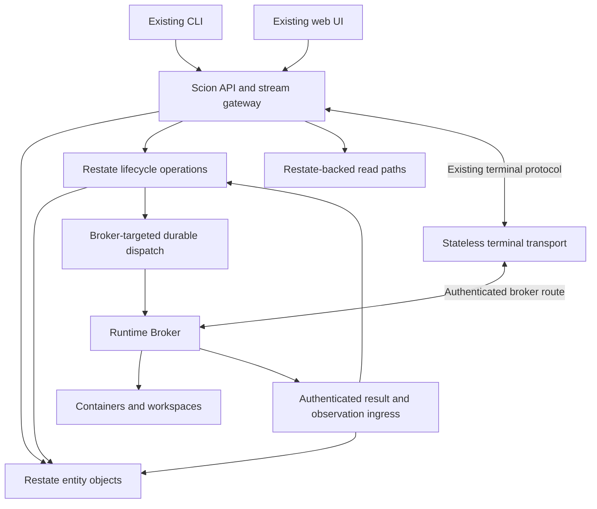

# Scion Restate-native Hub — Final Implementation Plan

**Status:** proposed implementation design, not completed implementation or verified platform certification.

**Supersedes:** `plan1.md` and `plan2.md` for implementation sequencing. Incorporates the findings in `plan2.red.md`.

## 1. Outcome and hard boundaries

Deliver a complete Scion distribution whose authoritative application metadata, coordination, durable work, indexes, and application events live in Restate.

- No SQLite, PostgreSQL, AlloyDB, Ent ORM, SQL store adapter, SQL-backed queue, relational read model, or fallback to the existing Hub in the delivered runtime.
- Use Restate natively: short serialized object mutations, uniquely identified durable operations, journaled execution, durable timers, and verified query facilities.
- Preserve the existing CLI/web HTTP, authentication, upload, event, and terminal contracts. Internal implementation changes do not justify silently changing consumer behavior.
- Preserve the Hub/Broker separation: Hub owns policy and desired state; Runtime Broker owns execution and runtime observation; harness-specific behavior remains in `pkg/harness`.
- No new general-purpose in-process `Hub` or `Store` provider interface. Do not rebuild a relational adapter architecture around Restate.
- No silent scope reductions. Every existing capability must be migrated, explicitly proven unnecessary, or removed with explicit maintainer approval before release.

### What “Restate-only” means

Restate is the only authoritative application metadata and orchestration store. Scion must not introduce a second database for indexes, deduplication, sessions, logs of domain events, broker task queues, or cleanup recovery.

Container runtimes, Git workspaces, private key files, configuration files, and bulk artifact payloads remain real external resources. Existing filesystem/object storage may retain bulk bytes; Restate owns their identities, references, permissions, lifecycle, and integrity metadata. These resources are not substitutes for a second application database. Broker runtime labels may identify an actual resource for reconciliation; they must not become a shadow Hub.

A stateless PTY proxy is allowed. Raw terminal traffic is not automatically journaled as domain state. If bulk payloads must also move into Restate, that is a separate storage decision requiring capacity and API evidence—not an implicit claim of this migration.

## 2. Product and distribution decision

### Ship a Restate-native distribution, not a dual-engine binary

Develop on an isolated migration branch while the existing implementation remains the behavior reference. During development, temporary source coexistence is acceptable; dependencies on the old Hub are not acceptable in the new executable path.

The final branch builds the normal Scion executable and server commands with the Restate Hub implementation. Relational source, startup paths, and unused dependencies are removed from that distribution after conformance and cutover gates pass. Do not use a runtime backend flag to keep SQL initialization or a hidden fallback in the final executable.

The relational implementation remains available through existing source/release history. Maintaining it as a separately released branch or project is a legitimate product choice, but is not a deliverable or maintenance promise of this plan. If maintainers require simultaneous maintained releases, establish separate release ownership and dependency isolation before cutover; do not weaken the Restate-only artifact requirement.

### Pluggability is the complete Scion network contract

Users may select an independently implemented compatible Hub by endpoint. Compatibility includes:

- Routes, request/response shapes, status codes, errors, pagination, and cancellation behavior.
- Authentication, authorization, sessions, tokens, uploads, and signed-resource access.
- SSE/event semantics, terminal protocols, reconnect behavior, and broker-facing contracts.
- Applicable version negotiation and startup configuration.

A black-box conformance suite makes this meaningful. Merely exposing `/api/v1` does not. Ordinary users should not need Restate SDK knowledge or direct access to its ingress/admin/query endpoints.

## 3. Architecture

### Component responsibilities

| Component | Owns | Must not do |
|---|---|---|
| API gateway | Public contracts, identity verification, policy checks, validation, error mapping, streams | Own durable state, open SQL stores, expose unrestricted Restate admin/query access |
| Entity objects | Authoritative entity state and short serialized mutations | Hold exclusive locks while waiting for long runtime operations |
| Lifecycle operations | Provision/start/stop/delete/reprovision sequencing, retry, cleanup, uncertain-outcome recovery | Assume journaled external effects are exactly once |
| Query layer | Keyed reads, bounded indexes, authorized DataFusion queries | Introduce a relational read model or expose arbitrary client SQL |
| Dispatch layer | Durable broker-addressed commands, authenticated result correlation | Treat an awakeable or network connection as a complete delivery protocol |
| Runtime Broker | Idempotent physical effects, fencing, resource inspection, execution results | Decide project policy or accept obsolete authority epochs |
| Stream adapter | Existing client protocols, replay where contracted, backpressure | Rely on internal service-protocol frames as an undocumented PTY API |

### Code organization

Use `pkg/restatehub` as the initial implementation area, with domain objects, operation handlers, query adapters, and the service host separated by responsibility. Keep the HTTP boundary separate from object/workflow code, without inventing a generic backend abstraction.

Extract existing transport types, pure validation, and reusable policy evaluation where they do not import SQL-backed initialization. Inspect imports before reusing code. Reuse is preferable to copying handlers, but carrying the old server/store dependency graph into the new process is not reuse worth keeping.

Retain existing `cmd` entry points and server lifecycle behavior. Any genuinely new command requires the repository's agent-mode and Windows availability decisions. New user-facing experimental exposure follows the experiment registry and server-side enforcement rules.

## 4. Evidence policy and early proof obligations

The local Restate checkout and existing team deployment/benchmark experience are useful inputs. They do not certify every required feature combination. Record exact server, SDK, and hosting versions from live sources and pin reviewed dependencies before implementation.

The following proofs close specific decisions. Run them in disposable environments, never against active project agents or production state.

| Proof | Required observation | Decision it closes |
|---|---|---|
| SDK replay and cancellation | Actual handler replay, terminal/retryable errors, cancellation, and cleanup behavior | Supported operation implementation and cancellation mechanism |
| Short object mutation plus durable dispatch | Committed ownership transition cannot permanently lose its required operation launch | Atomic/recoverable command acceptance protocol |
| Targeted broker delivery | Two brokers register; only the addressed broker executes; reconnect retains command identity | Broker routing, registration, and dispatch mechanism |
| NAT transport | Lifecycle commands and actual terminal traffic work with inbound broker connectivity blocked | Supported hosted control/data transport |
| State queries | Actual schema/functions, authorization integration, freshness, ordering, pagination, and cost | Allowed DataFusion route classes |
| Browser boundary | Real login/session flow and project list through the new gateway | Gateway auth/session/origin topology |
| Workstation host | Explicit start, readiness, registration, stop, and restart preserve state | Server supervisor and local data layout |

Internal HTTP/2 bidirectionality is not proof of public streaming. A Cloud tunnel client is not proof that its server counterpart exists in the target hosting environment. `defer`, `Run`, or any proposed compensation API is not proof of crash-safe cleanup. Verify exact SDK symbols and protocol paths before writing integrations; this document does not prescribe unverified API signatures.

Failure of a platform proof requires a concrete Restate-only design amendment and repeatable evidence. It does not authorize SQL fallback or deletion of an affected feature.

## 5. State ownership and bounded layout

Names below are design names, not claims that corresponding implementations already exist. Use canonical `project` terminology.

| Owner | Authoritative state | Layout and consistency rule |
|---|---|---|
| `AgentObject[agent_id]` | Identity, project, desired/observed lifecycle, current run, generation, assignment, active operation, cleanup/deletion state | Short exclusive transitions; shared reads return documented intermediate states |
| `AgentOperation[operation_id]` | One lifecycle operation's progress, external-effect references, compensation progress, outcome | Unique immutable operation identity; never reuse a completed workflow key |
| `ProjectObject[project_id]` | Project metadata and configuration references | Keep high-frequency agent summaries outside this object |
| Project/name claims | Unique names/slugs and their owner tokens | Exact lookup key; conditional release only by owning token |
| Project agent indexes | Bounded summaries and membership | Partitioned pages/buckets; updates carry source revision; repairable derived state |
| `QuotaObject[scope_id]` | Capacity and reservation ownership | Tokenized reservations, not anonymous increments; monitor scope contention |
| `BrokerObject[broker_id]` | Registration, capability/profile references, presence epoch, routing identity | Separate heartbeat state from long command waits |
| Broker command state | Command identity, target, operation/generation, delivery and result state | Bounded pending/history layout; terminal retention and dedup horizon specified |
| Identity/policy objects | Users, groups, memberships, roles, constraints, delegations | Explicit lookup owners and policy versions; no single unbounded global registry |
| Session/token objects | Session validity, expiry, revocation and credentials metadata | Token values protected; expiry backed by durable timers and validated on use |
| Configuration objects | Templates, harness configs, skills, environment metadata, artifact references | Versioned payloads; bulk bytes remain in existing supported payload storage |
| Conversation/event objects | Messages, domain events, delivery state | Bounded segments with sequence IDs, retention, replay/gap semantics |
| Schedule objects | Definition, revision, next occurrence, occurrence identities | Delayed work checks current revision; duplicate occurrences cannot execute twice as new work |
| Secret metadata objects | Encrypted secret references/value metadata and key version | Access controlled; do not leak plaintext into journals or queries |
| Audit/maintenance operations | Audit events and maintenance progress | Bounded retention, restricted access, inspectable repair actions |

The capability inventory must map all actual store interfaces and background responsibilities into owners, including capabilities not represented in this table. This table is a starting design, not permission to omit features.

### State rules

1. Every authoritative datum has one owner. Summaries are derived and repairable.
2. State envelopes carry a schema version. Operations carry a behavior/version identity sufficient for replay-compatible deployment.
3. Collections require explicit size bounds, partition/page boundaries, and retention before production use.
4. Do not clear an agent's state until stale activity can no longer affect it. Keep a compact deletion tombstone and generation fence; agent IDs are not reused.
5. Tombstone/dedup garbage collection requires a proven horizon covering retries, retained commands, delayed messages, and supported restores. Without that proof, retain the fence.
6. Timers contain the relevant revision/generation. Obsolete timers are harmless, not authoritative instructions.

## 6. Lifecycle protocol

This is the core design. Restate replaces execution machinery; Scion still owns these invariants.

### 6.1 Identity model

- `agent_id`: immutable resource identity.
- `run_id`: one logical runtime incarnation; new for a new incarnation, stable across retries.
- `generation`: monotonically advanced by the authoritative agent object when a new control operation supersedes earlier work.
- `operation_id`: one accepted lifecycle request; stable across execution retries.
- `command_id`: one broker side-effect instruction; derived from operation and step identity, not regenerated on retry.
- `reservation_id`: stable token tied to agent/run, quota scope, and operation intent.
- `authority_epoch`: installation/restore fencing identity. Not a wall-clock timestamp.
- `broker_epoch`: identity of the currently authorized broker registration/session.

A broker command/result carries the relevant IDs, target broker, expected resource identity, command kind, and payload/version digest. A repeated ID with a different payload is rejected rather than silently treated as the same operation.

Preserve any existing request-idempotency mechanism. Do not invent a deduplication key from request body equality: identical start requests can be intentional. If the public API supplies no retry key, define state-based duplicate behavior consistent with its current contract and document which ambiguous HTTP retries cannot be distinguished.

### 6.2 Accepting work without holding a long object lock

1. Gateway authenticates and authorizes the request, validates its public contract, and calls the agent owner.
2. A short exclusive mutation checks current state, duplicate/conflict semantics, and ownership. It records the new operation/generation and desired state.
3. Start the uniquely identified durable operation through a verified crash-safe state-and-send pattern. If the SDK cannot provide the required ordering directly, maintain a durable pending-operation record with an idempotent reconciliation trigger; prove recovery from every crash boundary.
4. Return the existing API's response shape and waiting semantics. If the API waits for an outcome, the gateway waits outside the object lock with the existing timeout behavior.
5. The operation performs external work and calls short object transitions to record progress and finalize.
6. Finalization succeeds only if operation ID, generation, and authority match current ownership. Stale results trigger reconciliation of physical effects; they are not simply discarded and forgotten.

Business cancellation is an explicit state transition and cleanup protocol. Administrative forced cancellation/termination is a restricted operational action, not the normal stop implementation.

### 6.3 Lifecycle transitions

Internal states below map to existing public status values; they are not new client-visible enum values by default.

| Request/event | Authoritative action | Physical/recovery behavior |
|---|---|---|
| Create/start accepted | Record desired running, operation, generation, run identity, pending progress | Claim name, reserve capacity, provision and start through stable command IDs |
| Provision confirmed | Record exact resource identity under current operation | Launch only if generation/authority still valid |
| Launch confirmed | Set observed running only for current run/generation | Release operation ownership; retain reservation while resource consumes capacity |
| Stop during launch | Record desired stopped and superseding operation/generation promptly | Fence late launch; stop or reconcile any resource that already materialized |
| Stop while running | Record desired stopped and stop operation | Stop matching resource, confirm contract-specific retained/deleted resource behavior |
| Delete accepted | Record desired deleted and deletion operation; reject conflicting new lifecycle work | Fence older commands, remove matching resources, release tokens, remove indexes/name claims |
| Runtime outcome uncertain | Record uncertain/reconciling progress | Inspect by operation/resource identity; never assume absence from timeout alone |
| Terminal business failure | Record failure reason and cleanup obligations | Explicit compensations run until complete or visibly repair-required |
| Stale completion | Refuse authoritative state transition | Locate and reconcile obsolete physical effect without touching newer resources |
| Delete finalized | Retain tombstone/generation and operation outcome | No identity reuse; purge retained detail only under retention policy |

Stop semantics must preserve existing distinctions between stopped containers, retained workspaces, deleted resources, and retained quota. Release capacity only when the corresponding resource no longer consumes it under the existing policy.

### 6.4 Provisioning and compensation

For an initial launch:

1. Obtain a tokenized name claim if required by the public uniqueness rules.
2. Reserve required scopes using stable reservation IDs.
3. Resolve configuration/credentials through authorized boundaries without persisting unnecessary plaintext.
4. Persist provisioning intent before requesting the external effect.
5. Provision by stable command/run identity; on uncertainty, inspect before attempting a distinct effect.
6. Launch the matching resource after a generation/authority check.
7. Commit observed state and required index updates under current operation ownership.

On failure or cancellation:

- Reconcile any possibly-created resource first, even if no successful provision response was recorded.
- Stop/delete only resources owned by the failed operation/run as appropriate; never clean up a newer run by name alone.
- Release capacity only after physical absence or the relevant non-consuming state is confirmed.
- Conditionally release name claims and derived index entries using owner identity.
- Record cleanup completion, or an explicit repair-required condition if an invariant cannot be restored automatically.

Cleanup is durable application work with recorded progress and its own retry policy. It must not rely on a process-local `defer` or a cancelled request context. Cleanup evidence survives a worker crash between any two effects.

### 6.5 Quotas and transfers

A reservation operation is `reserve(token, owner, amount)` with stable semantics: duplicate same-token/same-payload requests return the original outcome; token reuse with different content is rejected. Release is conditional on token ownership and idempotent. A used token is not silently recreated after release.

Multi-scope reservation acquires scopes in a deterministic order and compensates completed reservations on failure. Intermediate reservations may temporarily reduce available capacity; they must not permit under-accounted allocation.

For transfer, reserve destination capacity before releasing source capacity. Complete the physical placement/ownership transition and confirm resource consumption before releasing the source. Temporary over-reservation is acceptable; double allocation or premature release is not. If destination capacity is unavailable, keep the source reservation and report the defined failure.

Define conservation assertions per quota scope. Do not replace a required exact quota with approximate counters to improve throughput.

## 7. Broker effects, delivery, and fencing

### 7.1 External effects are idempotent by design

Runtime resources carry immutable Scion ownership metadata sufficient to locate them by agent/run/operation identity after a response is lost. Use deterministic runtime names where supported, plus inspectable labels/metadata. Verify equivalent behavior for every supported runtime; do not assume Docker semantics cover Kubernetes or Podman.

Before retrying an uncertain effect, inspect for the existing result. Broker restart reconstructs resource observations from the runtime and reconciles with Restate; it does not need an independent SQLite task database.

### 7.2 Fencing reaches the physical boundary

Serialize conflicting physical actions for an agent within an authorized broker session. A superseding generation prevents older work from initiating new effects. If an older effect is already in progress and cannot be interrupted, reconcile it before declaring the superseding operation physically complete.

Recheck authority before launching a provisioned container, and reconcile after long calls return. An object refusing a stale report is not enough: a stale physical container must also be stopped/deleted or adopted only by an explicit safe protocol.

A broker replacement must not share writable runtime authority with a still-active predecessor without an enforceable fencing mechanism. If the platform cannot fence a partitioned predecessor, require verified shutdown/isolation before takeover. An unreachable broker is not proof that its containers are gone. Do not release its capacity and launch a replacement on that assumption.

### 7.3 Transport selection

Keep command semantics independent of transport, without creating a generic Hub abstraction.

- **First slice:** use the existing reachable broker execution API through the new operation protocol, if it can run without old Hub state. Add idempotency/fencing required by this plan.
- **Target hosted path:** prefer an authenticated, supported Restate tunnel when its server-side availability and broker targeting pass the early proof.
- **Otherwise:** use broker-initiated delivery with authoritative pending commands in Restate. A stateless connection adapter may carry notifications and PTY bytes; it cannot own a durable queue.

Choose and document the supported topology before hosted rollout. Do not ship several untested alternatives as a substitute for making a decision.

### 7.4 Durable delivery protocol

Each command moves through persisted states equivalent to pending, offered, acknowledged, completed, failed, or reconciling. Delivery can repeat; command identity cannot change.

- Enqueue is an exclusive owned mutation, not a write hidden in a shared handler.
- Acknowledgment means receipt, not successful physical completion.
- Results are accepted only from the target authorized broker/session and matched to command identity and payload.
- Lost responses are recoverable through retained result/state inspection.
- Reconnect resumes by durable command identity/cursor, not in-memory connection position.
- Duplicate results are harmless; obsolete results remain available for reconciliation.
- Command expiry stops future delivery only according to operation policy; expiry does not prove no side effect occurred.
- Awakeables may wake an operation, but the durable command/result record remains sufficient when a waiter expires or is replaced.
- Offline queue bounds and backpressure are explicit. Do not accumulate an unbounded pending-task array.

## 8. Reads, indexes, and DataFusion

### Route-specific defaults

| Query family | Default implementation | Required guarantee |
|---|---|---|
| Agent/project/config lookup by ID | Authoritative keyed read | Correct current entity and authorization |
| Name/slug resolution | Dedicated claim/lookup owner | Unique mapping and ownership-safe deletion |
| Standard project agent listing | Bounded project index | Existing sort/filter/page behavior and documented mutation visibility |
| Agent status after mutation | Agent owner/operation read | No dependence on a lagging broad query |
| Cross-project/admin filtering and reporting | Verified DataFusion query over state/indexes | Authorized scope, bounded cost, supported freshness and pagination |
| Conversation/event history | Bounded ordered segments | Stable sequence/cursor, retention and gap behavior |

DataFusion remains part of the target, not a promise that arbitrary SQL over all state is an efficient serving path. Never expose arbitrary SQL or Restate query credentials to clients.

### Index protocol

Index updates carry source entity identity and monotonically comparable revision. Apply only current/newer updates; deletion revisions prevent late inserts from resurrecting membership. Keep a durable pending index-update obligation until acknowledged. Repair jobs compare authoritative state to derived entries and are themselves restartable.

Before returning a mutation response, satisfy any existing read-after-write membership guarantee using an acknowledged required index update. Do not wait for every optional/reporting summary to become current. Document which fields are current versus derived without breaking established public semantics.

Preserve existing pagination contracts. Use deterministic ordering with an identity tie-breaker internally. If the existing contract requires snapshot pagination, implement and test it; otherwise document the actual concurrent-update behavior and do not claim snapshot guarantees. No new client cursor format without compatibility review.

Authorization is part of query execution: constrain scope before returning results, avoid leaking counts or pagination metadata, and use trusted structured query construction. A broad query followed by casual application filtering is not an acceptable default security boundary.

## 9. Security and secrets

- Keep public clients at the Scion gateway. Restrict Restate service, query, and administrative access to appropriately scoped service identities.
- Preserve login/session, token, CSRF/origin, signed upload/download, and broker authentication behavior. Do not use a developer-auth bypass as the first slice's compatibility proof.
- Represent policy/session state in Restate. Pure policy evaluation may be reused, but its inputs must no longer depend on SQL.
- Define revocation separately from eventual container shutdown. New privileged operations must observe effective policy; protected mutations validate the relevant current authority rather than trusting stale gateway authorization indefinitely.
- Long-lived streams have an enforced revocation mechanism with a documented bound and fail-closed revalidation. Async runtime stop is not sufficient access revocation.
- Broker results and command requests are authenticated and scoped. An awakeable ID is not the whole security policy.
- Prefer encrypted envelopes or references in durable requests. Audit every place plaintext can enter Restate journals, retries, logs, queries, traces, and backups.
- Key material and rotation procedures must support encrypted state recovery. Test backup recovery with the required keys; a metadata backup alone is insufficient.
- Treat support/admin repair endpoints as privileged APIs with audit records, not unauthenticated shortcuts.

## 10. Events, logs, and terminal traffic

### Durable events and messages

Use stable event IDs and ordered sequence within the defined topic/stream scope. Persist bounded segments, explicit retention, and delivery state where delivery is part of the product contract. Choose a verified Go-compatible implementation or deliberately integrated service; do not assume a TypeScript pubsub package is automatically available to the Go backend.

The gateway preserves existing SSE/event shapes and reconnect semantics. Define duplicate handling, replay horizon, gaps after retention, slow-consumer limits, subscriber expiry, and backpressure. A live in-memory subscriber registry may accelerate fan-out but cannot be the durable event source.

Separate domain events from high-volume diagnostic/runtime logs. Retain existing bulk-log storage where applicable; if durable log replay is promised, specify its backing bytes and retention explicitly rather than using an unbounded object array.

### Interactive terminal

Preserve the existing WebSocket/client terminal protocol. Route through the authenticated Scion surface and selected reachable broker path, including NAT. Do not redirect browsers to otherwise unreachable private broker addresses.

Test input, output, resize, binary frames, exit, slow consumers, reconnect, policy revocation, and runtime disconnect. Keep terminal data transient unless a specific existing feature requires retention. Durable scrollback is not silently added by this migration.

Do not remove `pkg/wsprotocol` or control-channel code until its control and terminal responsibilities are separated and all consumers are migrated. Retaining a minimal stateless terminal transport does not violate Restate-only persistence.

## 11. Timers, schedules, retention, and repair

- Replace SQL polling with durable delayed work where it matches the obligation, not merely because a timer API exists.
- Schedule occurrences have stable IDs, definition revisions, timezone behavior, misfire policy, and duplicate suppression consistent with existing behavior.
- Heartbeat expiry and stale cleanup use broker epochs/generations; late timers cannot revoke a newer registration.
- Reconciliation remains necessary for uncertain external effects, restored state, derived indexes, and orphaned resources. Implement it as bounded durable work, not a new opaque polling subsystem.
- Classify errors: retryable infrastructure failure, terminal business rejection, obsolete operation, invariant violation, and repair-required state. Do not retry every error forever.
- Backpressure and admission limits apply to commands, queries, events, and maintenance work. Recovery traffic must not starve stop/delete operations.
- Expose operation age, queue delay, resource uncertainty, compensation backlog, index lag, query cost, hot keys, and retained storage growth. Logs must include safe correlation IDs without secrets.

## 12. Workstation, hosted deployment, and upgrades

### Workstation

`scion server start` explicitly supervises the supported Restate process plus Scion service host/gateway/Broker/web components as appropriate. Ordinary agent commands never start infrastructure implicitly.

Use one documented data directory under the resolved Scion configuration root, with global default `~/.scion/restate/`. Pin the supported Restate version. Verify distribution/platform support before installation code is written; do not assume one Rust binary works on every supported target.

Bind local administration and service endpoints to loopback with appropriate protection. Avoid fixed-port assumptions without collision handling and explicit configuration. Readiness means Restate is healthy, services are registered at the intended version, and Scion's required paths are usable. Shutdown drains/stops according to documented semantics and never deletes state.

### Hosted

Support the team's Restate hosting model with authenticated private service access, explicit storage/snapshot configuration, network policy, resource isolation, and independently deployable Scion service hosts. Measure interference from query scans and event workloads before sharing capacity with unrelated production applications.

### Schema/replay compatibility

Removing Ent migrations does not remove migrations. Version object state, operation behavior, and indexes. Use replay-compatible deployment or preserve old handler versions until their in-flight work finishes. Backfills are resumable durable operations with progress and validation.

Maintain an upgrade/downgrade safety policy. Remove the SQL-specific downgrade guard only when the replacement state/replay compatibility policy is enforced. A binary that cannot safely interpret current state must refuse unsafe startup/downgrade.

## 13. Backup, restore, and control-plane authority

Backup acceptance includes object state, in-flight work, required keys, artifact references, and retention expectations.

A restore is not a normal restart:

1. Fence or shut down old control-plane authority and affected brokers before admitting writes.
2. Establish a fresh authority epoch through an authenticated recovery ceremony that cannot be confused with the restored old epoch. Rotate/re-enroll broker authority as needed.
3. Keep ordinary mutations closed while inspecting live runtime resources and comparing them with restored state.
4. Reconcile resources created after the snapshot, pending commands, quota ownership, credentials, and indexes. Do not blindly replay provisioning against an already-populated runtime.
5. Resume only after the consistency report passes or explicit operator repair resolves discrepancies.

Do not assume a counter stored solely inside the restored snapshot fences post-snapshot activity. Do not allow two Hub authorities to manage the same runtime. The restore test must include containers that survived the control-plane restore.

## 14. Delivery sequence and acceptance gates

Broad inventory begins immediately, but full deep design of unrelated features does not block the first slice. Complete inventory is a release gate; executable lifecycle semantics are the first-slice gate.

### Milestone A — Boundary, inventory, and decisive proofs

**Deliver:** capability/contract matrix; first-slice import boundary; pinned platform choices; evidence for the proofs in Section 4; chosen supported broker topology.

Inventory routes, clients, store interfaces, background work, server lifecycle, security, payload storage, and supported runtimes. Classify existing tests as public behavior, required internal invariant, or obsolete implementation detail.

**Gate:** no unresolved platform assumption on the first slice's critical path. Browser auth and hardest required network route are demonstrated. Each remaining capability has a named owner and later milestone; unresolved details are not treated as implemented.

### Milestone B — Protocol implementation and complete lifecycle slice

**Deliver:** agent/project/name ownership, tokenized quota, lifecycle operations, broker idempotency/fencing, API gateway, keyed reads and project listing.

Implement Sections 6–7 before broad feature migration. Use real boundary authentication and authorization from the start.

**Gate:** unchanged CLI performs create → list → stop → delete against a real disposable runtime; browser login/list/status works through the real gateway. The new process starts without SQL configuration, initialization, or the old Hub. Inspect actual resources and reservations, not only HTTP responses.

### Milestone C — Failure proof before expansion

**Deliver:** deterministic fault scenarios and recovery evidence for the first slice.

**Gate:** pass the lifecycle/fencing/quota/restore scenarios in Section 15. A lost provision response does not create a second resource. Stop intent is recordable while the broker is offline. Cleanup progress survives restart. Uncertain effects remain visible and owned until reconciled.

### Milestone D — Full capability migration

**Deliver:** all remaining matrix entries: identities/policies, sessions, configuration, templates/skills, secrets, placement, schedules, messages, notifications, conversations, maintenance, audit, and any other discovered capabilities.

Implement bounded indexes/query paths, schema evolution, retention, and repair along with each feature. Port meaningful behavioral tests before removing old implementations.

**Gate:** full contract matrix is covered without stubs or relational state; authorization/revocation and index consistency scenarios pass. No feature is declared complete solely because its route exists.

### Milestone E — Streams and operational readiness

**Deliver:** all existing terminal/event/log behaviors; workstation supervision; hosted topology; dashboards/repair procedures; backup, restore, upgrade, and performance evidence.

Transport feasibility was proved in Milestone A; this milestone completes its product behavior, not its initial architecture decision.

**Gate:** actual CLI and browser terminal pass interaction/reconnect/security checks; NAT-isolated deployment works; resource/backpressure limits hold under representative load; restore reconciles surviving runtime resources.

### Milestone F — Cutover and pure-artifact release

**Deliver:** migration tool if existing data must be preserved, controlled cutover, final dependency removal, documentation and release evidence.

- Prefer an isolated fresh installation for initial validation; this does not waive existing-data migration requirements where applicable.
- For retained data, freeze writes, drain or explicitly reconcile in-flight operations, export, transform/import stable IDs and encrypted metadata, validate counts/ownership/references, and switch authority once.
- Never dual-write or switch requests opportunistically between Hub implementations.
- Rollback before new writes can restore the old authority after fencing the new one. After new Restate writes, rollback requires a validated reverse migration or an explicitly accepted data-loss recovery policy; an old snapshot is not transparent rollback.
- Remove replaced SQL source/dependencies/startup paths from the shipping branch. Retain extracted HTTP/security functionality and consumer-visible regression safeguards.
- Update installation, architecture, security, operations, migration, and release documentation. Run repository-required CI before commits; integrate local `main` according to repository rules and re-test conflict resolutions.

**Gate:** complete conformance, failure, clean-install, migration where required, and dependency audits pass. The release contains no hidden relational fallback and no unfinished matrix entry.

## 15. Verification matrix

| Scenario | Required observable result |
|---|---|
| Duplicate request/command | Defined API semantics; same command identity cannot create another physical resource |
| Provision succeeds, response is lost | Retry discovers the existing resource; reservation and resource counts remain correct |
| Stop during offline launch | Stop intent accepted without waiting on the launch object's lock; obsolete launch cannot become current |
| Stop races in-progress provision | Physical effect is fenced or subsequently reconciled before stop is declared complete |
| Delete followed by old broker result/timer | Tombstone/generation rejects resurrection; stale resources are reconciled |
| Broker restart or replacement | Runtime inspection recovers identity; old broker authority cannot concurrently mutate the same runtime |
| Quota transfer interrupted | Ownership is inspectable; no unaccounted resource or duplicate capacity grant |
| Compensation interrupted | Remaining cleanup resumes; newer run resources/reservations are untouched |
| Malformed/forged broker completion | Rejected without changing operation or quota state |
| Revocation during request/stream | New privileged effects denied under effective policy; stream access ends under the specified bound |
| Cross-project query/pagination | No data/count/cursor leakage; documented ordering and consistency hold |
| Index update lost/reordered | Durable repair restores membership; deletion revisions prevent stale resurrection |
| Large project/conversation/history | Bounded values/segments; observed memory/storage/queue behavior stays within the agreed envelope |
| Old schedule/timer after revision change | No obsolete occurrence or stale presence mutation |
| Worker/Restate node failure | Authoritative progress survives; no distinct duplicate external effect |
| Upgrade with in-flight operation | Replay remains compatible or old handler continues safely; unsafe downgrade refused |
| Restore with newer containers alive | New authority reconciles post-snapshot effects before reopening mutations |
| NAT broker and actual terminal | Targeted lifecycle dispatch, terminal resize/input/output/reconnect all work |
| Clean Restate-only installation | No relational connection, migration, embedded SQL store, or old Hub initialization |

Use disposable runtime resources, never active project agents. For regressions, demonstrate failure against the broken behavior where practical, then pass after the fix. Mock only external boundaries where needed; real-path smoke evidence is mandatory. Do not add tests that merely assert wiring or copied implementation defaults.

### Performance and capacity gates

Before load testing, record a reproducible workload envelope and pass/fail thresholds: concurrent agents and brokers, operation rate, project size, history volume, list/filter mix, stream clients, offline backlog, and recovery traffic.

Measure the existing public contract path under that envelope and set explicit approved limits for lifecycle API latency, stop-intent acceptance, list latency/freshness, terminal latency, reconnect recovery, timer lateness, recovery duration, storage growth, and resource use. Do not invent thresholds from earlier unrelated benchmarks or accept whatever the prototype produces. Required semantics are not negotiable for throughput.

Measure authored coordination logic removed separately from generated ORM output. Report new index/reconciliation/security code and operational dependencies as well. Lines deleted are evidence of scope, not proof of correctness or the release success metric.

## 16. Completion checklist

- [ ] One authoritative owner for every durable capability; complete contract matrix.
- [ ] Restate-only shipping artifact with no relational fallback or old Hub dependency.
- [ ] Existing CLI/web/broker contracts demonstrated through conformance tests and real surfaces.
- [ ] Lifecycle identity, fencing, quotas, compensation, deletion, and uncertain outcomes proven.
- [ ] Correct targeted broker delivery and NAT terminal path.
- [ ] Bounded state/index/event layouts with repair and retention.
- [ ] Effective authentication, authorization, revocation, and secret/journal protections.
- [ ] Queries meet documented consistency, authorization, and capacity requirements.
- [ ] Explicit workstation and hosted lifecycle, version pinning, and supported platforms.
- [ ] Replay/state evolution, downgrade safety, backup/restore, and runtime reconciliation.
- [ ] Controlled migration/cutover where needed; no competing authorities or silent data-loss rollback.
- [ ] Relevant behavior tests preserved, obsolete code removed, documentation updated, CI passed.

## First implementation action

Start Milestone A with a broad capability inventory and narrow proofs for broker targeting/NAT, SDK cancellation/state-and-send semantics, and the real browser/API boundary. Turn the lifecycle protocol above into concrete versioned request/state types and transition tests for Milestone B. Do not begin by deleting SQL code, wrapping the entire Hub in a generic interface, or implementing every entity before a real agent can complete its lifecycle.

**Success is a complete, independently operable Restate-native Scion—not a SQL-shaped Hub stored in Virtual Objects, and not a launch demo presented as a finished replacement.**
