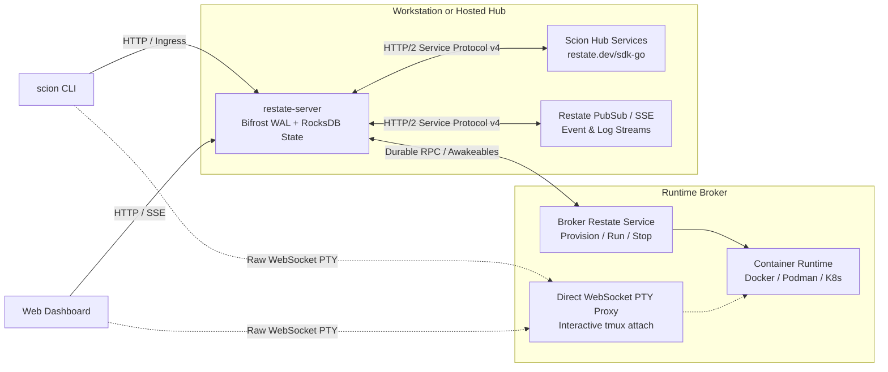

# Plan: Replacing Scion Hub's SQL/ORM & Custom Engines with Restate

## 1. Objective & Architectural Thesis

Scion’s Hub currently acts as a custom-built distributed workflow engine, state machine coordinator, lease manager, timer scheduler, and message broker built on top of relational databases (SQLite / PostgreSQL) and Ent ORM. 

This relational foundation has forced Scion to hand-roll primitives that do not belong in an application layer:
- **614,662 lines** of Ent ORM codegen (`pkg/ent`) and SQL store adapters (`pkg/store`).
- **11,260 lines** of custom distributed leases, renewal tickers, claim IDs, and saga rollback state machines (`pkg/hub/agent_create_tx.go`, `pkg/hub/agent_delete_engine.go`, `pkg/hub/start_claim.go`).
- **5,919 lines** of WebSocket RPC multiplexing and control channels (`pkg/hub/controlchannel.go`, `pkg/wsprotocol`).
- Custom SQL-backed outbox queues (`BrokerDispatchStore`, `MembershipLossCheckStore`), timer tables (`ScheduledEventStore`, `ScheduleStore`), and `LISTEN/NOTIFY` polling loops.

**Goal**: Replace the relational database, Ent ORM, custom lease/saga engines, and control channel with **Restate** (`restate-server` + `restate.dev/sdk-go`), cutting over cleanly (no legacy compatibility shims per repository alpha policy) and deleting ~630,000+ lines of accidental complexity.

---

## 2. Target Architecture

### Process & Deployment Topology
1. **Workstation (`scion server start`)**:
   - Supervises `restate-server` (single static Rust binary using embedded RocksDB storage under `~/.scion/restate-data/`) alongside the Go Hub/Broker Restate handlers and Web UI on loopback.
   - Replaces `modernc.org/sqlite` and all schema auto-migration startup passes (`cmd/server_migrate*.go`, `cmd/server_backfill*.go`).
2. **Hosted Deployment**:
   - Runs a Restate cluster (or single-node instance with durable volume/object-store snapshots) fronting stateless Scion Hub handler instances and remote Runtime Brokers.

---

## 3. Core Primitive Mapping (What Replaces What)

| Current Scion Mechanism | Current Files / Interfaces | Restate Replacement |
| :--- | :--- | :--- |
| **Agent Create Saga & Rollbacks** | `pkg/hub/agent_create_tx.go` (`compensateAgentCreate`, `cleanupFailedCreate`, `createRowHeldCheck`) | **`AgentProvisionWorkflow` (`restate.Workflow`)**: Linear `restate.Run` steps with `defer` reverse compensation slice. |
| **Agent Delete Lease Engine** | `pkg/hub/agent_delete_engine.go` (`deletionEngine`, lease renewal, `in_doubt`, `rollback`) | **`AgentObject` (`restate.Object`)**: Keyed by `agent_id`. Single-writer serialization eliminates concurrent start/delete races. |
| **Start Claims & Launch Keepalives** | `pkg/hub/start_claim.go`, `pkg/store/launch.go` (`StartClaimID`, `LaunchKeepaliveSeconds`, reaper) | **Restate Awakeables (`restate.Awakeable`) + Durable Timers**: Workflow awaits container launch completion or times out deterministically via `restate.WaitFirst`. |
| **Broker Control Channel & Outbox** | `pkg/hub/controlchannel.go`, `pkg/store.BrokerDispatchStore` | **Durable RPC & Awakeables**: Direct Restate service calls to Broker endpoints or Awakeable resolution for NAT-traversing brokers. |
| **Scheduled Events & Cron** | `pkg/store.ScheduledEventStore`, `pkg/store.ScheduleStore` | **Durable Timers**: `restate.Sleep(ctx, d)` and delayed sends (`restate.WithDelay(d)`). |
| **Membership Loss Work Queue** | `pkg/store.MembershipLossCheckStore`, `pkg/hub/membership_loss.go` | **Async Service Invocations**: `restate.ObjectSend(ctx, "AgentObject", agentID, "RevokeAndStop").Send(...)`. |
| **Quota Reservations & Transfers** | `pkg/store.QuotaStore` (`TransferBrokerReservation`, `TransferAgentCond`) | **`QuotaObject` (`restate.Object`)**: Keyed by `scope_id` (`project_id` or `broker_id`). Atomic counter mutations serialized per key. |
| **Conversations & Messaging** | `pkg/store.MessageStore`, `pkg/store.ConversationStore`, `pkg/eventbus` | **`ConversationObject` (`restate.Object`) + PubSub SSE**: Durable message append + offset-indexed SSE streaming to Web/CLI. |
| **Admin Maintenance Runs** | `pkg/hub/admin_maintenance_run.go` (`maintenanceCleanupContext`, panic recovery) | **`MaintenanceWorkflow` (`restate.Workflow`)**: Keyed by `run_id`; inspectable and cancellable via Restate Admin API. |
| **Ent ORM & SQL Adapters** | `pkg/ent/**` (755 files), `pkg/store/**` (381 files) | **Virtual Object K/V State**: `restate.Get[T]`, `restate.Set[T]`, `restate.ClearAll` backed by RocksDB/Bifrost. |

---

## 4. Detailed Restate Service & Virtual Object Design

### 4.1 `AgentObject` (Virtual Object — Key: `agent_id`)
Encapsulates the state and serialized lifecycle transitions of a single agent.
- **State Keys**:
  - `"info"`: `AgentInfo` (name, slug, projectID, ownerID, phase, runtimeBrokerID, containerID, appliedConfig, labels, ancestry)
  - `"holds"`: `[]AgentHold`
  - `"credentials"`: `AgentCredentialMetadata`
  - `"run_history"`: `[]PreviousRun`
- **Exclusive Handlers (Serialized per `agent_id`)**:
  - `Create(ctx restate.ObjectContext, req CreateAgentRequest) (AgentInfo, error)`:
    Executes the creation saga:
    1. Calls `ProjectObject[req.ProjectID].ClaimSlug(req.Slug)` (adds compensation: `ReleaseSlug`).
    2. Calls `QuotaObject[req.BrokerID].Reserve(1)` (adds compensation: `Release(1)`).
    3. Mints agent credentials via `restate.Run`.
    4. Dispatches provisioning to `BrokerObject[req.BrokerID]` or awaits an Awakeable if the broker is pull-based (adds compensation: `BrokerDeleteContainer`).
    5. Sets `"info"` state to `PhaseRunning` and returns.
    If any step returns a `restate.TerminalError` or the invocation is cancelled, the `defer` block runs all registered compensations in reverse order and clears object state.
  - `Start(ctx restate.ObjectContext, req StartRequest) (AgentInfo, error)`
  - `Stop(ctx restate.ObjectContext, req StopRequest) (AgentInfo, error)`
  - `Delete(ctx restate.ObjectContext, req DeleteRequest) (DeleteResult, error)`:
    No lease claims needed—because `Delete` is an exclusive handler on `AgentObject`, no `Start`, `Restart`, or `Create` can interleave with it.
    1. Calls `Broker.DeleteContainer` inside `restate.Run`.
    2. Calls `QuotaObject.Release`.
    3. Calls `ProjectObject.RemoveAgentIndex`.
    4. Calls `restate.ClearAll(ctx)` to purge the Virtual Object.
- **Shared Handlers (Concurrent Reads, Zero Blocking)**:
  - `Get(ctx restate.ObjectSharedContext) (AgentInfo, error)`: Reads `"info"` without blocking an ongoing long-running `Start` or `Create`.

### 4.2 `ProjectObject` (Virtual Object — Key: `project_id`)
Manages project metadata, settings, membership, and the index of agents belonging to the project.
- **State Keys**:
  - `"metadata"`: `ProjectMetadata` (name, slug, gitRemote, defaultBrokerID, sharedDirs)
  - `"agents"`: `map[string]AgentSummary` (slug &rarr; summary for fast `scion list` without fan-out)
  - `"env_vars"`: `map[string]string`
  - `"secrets"`: `map[string]EncryptedSecret`
  - `"members"`: `map[string]RoleBinding`
- **Exclusive Handlers**:
  - `RegisterAgent`, `UnregisterAgent`, `UpdateAgentSummary`
  - `UpdateConfig`, `SetSecret`, `DeleteSecret`, `SetMember`
- **Shared Handlers**:
  - `GetProject`, `ListAgents`, `ResolveEnvironment`

### 4.3 `BrokerObject` (Virtual Object — Key: `broker_id`)
Tracks Runtime Broker registration, capabilities, profiles, capacity, and NAT-friendly task dispatch.
- **State Keys**:
  - `"registration"`: `BrokerRegistration` (name, endpoint, capabilities, profiles, status)
  - `"pending_tasks"`: `[]BrokerTask` (for pull/webhook brokers behind NAT)
- **Handlers**:
  - `Register`, `Heartbeat`
  - `Dispatch(ctx restate.ObjectSharedContext, cmd BrokerCommand)`:
    - If broker has direct HTTP/2 reachability: invokes Broker Restate service directly.
    - If broker is behind NAT: creates `restate.Awakeable`, pushes task to broker's SSE/poll stream, and suspends until the broker resolves the awakeable via `POST /restate/awakeables/{id}/resolve`.

### 4.4 `ConversationObject` & `StreamTopic` (Virtual Object — Key: `conversation_id` / `agent_id`)
Replaces `ConversationStore`, `MessageStore`, and `pkg/eventbus`.
- **State Keys**:
  - `"messages"`: `[]Message`
  - `"subscribers"`: `map[string]SubscriberInfo`
- **Handlers**:
  - `PostMessage(ctx restate.ObjectContext, msg Message)`: Appends message to state, triggers durable delivery to target agent via `restate.ObjectSend`, and notifies SSE listeners.
  - `Stream(ctx restate.ObjectSharedContext, offset int)`: Returns messages from `offset` and resolves an awakeable when new messages arrive (same pattern as `@restatedev/pubsub`).

### 4.5 `AuthzRegistryObject` (Virtual Object — Key: `scope_id`)
Replaces `RoleStore`, `GroupStore`, `AccessConstraintStore`, `DelegationEdgeStore`, and `AgentDelegationStore`.
- Stores role bindings, delegation edges, and access constraints scoped to `"system"` or `"project:<id>"`.
- Delegation revocation (`RevokeAll`) becomes an atomic mutation on the object followed by asynchronous `restate.ObjectSend` calls to halt affected child agents.

---

## 5. Phased Execution Plan

### Phase 1: Restate Runtime & Go SDK Foundation
**Goal**: Wire `restate-server` supervision into `scion server start` and establish the Go SDK service host in `pkg/restatehub`.
1. Add `github.com/restatedev/sdk-go` to `go.mod`.
2. Create `pkg/restatehub/daemon.go` to supervise the `restate-server` process in workstation mode (storing data in `~/.scion/restate/`, configuring ports for ingress `:8080` and admin `:9070`, and auto-registering the Hub's Restate service endpoint on startup).
3. Create `pkg/restatehub/server.go` binding the core Virtual Objects (`AgentObject`, `ProjectObject`, `BrokerObject`, `QuotaObject`, `ConversationObject`, `AuthzRegistryObject`).
4. Verify with a smoke test that `scion server start` boots `restate-server`, registers the Go SDK services, and serves health checks.

### Phase 2: Agent Lifecycle, Quotas, & Sagas (`AgentObject` & `QuotaObject`)
**Goal**: Replace `agent_create_tx.go`, `agent_delete_engine.go`, `start_claim.go`, and `QuotaStore` with Restate Virtual Objects and Sagas.
1. Implement `AgentObject` (`pkg/restatehub/agent_object.go`) with `Create`, `Start`, `Stop`, `Restart`, `Reprovision`, `Delete`, and shared `Get` handlers.
2. Implement `QuotaObject` (`pkg/restatehub/quota_object.go`) with `Reserve`, `Release`, and `Transfer`.
3. Rewrite `pkg/hub/handlers_agents.go` to invoke `AgentObject` via the Restate ingress client instead of calling `s.store`, `s.startClaim`, `s.compensateAgentCreate`, and `s.deletionEngine`.
4. Delete:
   - `pkg/hub/agent_create_tx.go` & `pkg/hub/agent_create_tx_test.go`
   - `pkg/hub/agent_create_nil_guard_test.go` & `pkg/hub/agent_create_stage_test.go`
   - `pkg/hub/agent_delete_engine.go` & `pkg/hub/agent_delete_engine_*_test.go`
   - `pkg/hub/start_claim.go` & `pkg/hub/start_claim_test.go`
   - `pkg/store/start_claim.go`, `pkg/store/deletion*.go`, `pkg/store/launch*.go`

### Phase 3: Broker Dispatch & Awakeables (`BrokerObject`)
**Goal**: Replace the custom WebSocket control channel (`pkg/hub/controlchannel.go`) and SQL dispatch outbox (`BrokerDispatchStore`) with Restate Awakeables and RPC.
1. Implement `BrokerObject` (`pkg/restatehub/broker_object.go`) for broker registration, heartbeat tracking, and command dispatch.
2. Update `pkg/runtimebroker` to either expose a Restate service endpoint directly or pull tasks from `BrokerObject` and complete them via Restate's Awakeable HTTP endpoint (`/restate/awakeables/{id}/resolve`).
3. Keep `cmd/attach.go` and the broker's raw WebSocket PTY handler strictly for interactive `tmux` terminal attachment (`GET /api/v1/agents/{id}/pty`), removing control-plane RPC multiplexing from WebSockets.
4. Delete:
   - `pkg/hub/controlchannel.go` & `pkg/hub/controlchannel_test.go`
   - `pkg/wsprotocol/` (control channel RPC envelopes; retain only minimal PTY resize/frame helpers if needed)

### Phase 4: Projects, Templates, Secrets, & Authz (`ProjectObject` & `AuthzRegistryObject`)
**Goal**: Move project configuration, environment variables, secrets, templates, and authorization state out of SQL into Virtual Objects.
1. Implement `ProjectObject` (`pkg/restatehub/project_object.go`) storing project metadata, agent summaries, env vars, secrets, and template manifests (blob payloads remain in `pkg/storage` filesystem/GCS).
2. Implement `AuthzRegistryObject` (`pkg/restatehub/authz_object.go`) storing users, groups, role bindings, delegation edges, and access constraints.
3. Replace `MembershipLossCheckStore` polling with immediate `restate.ObjectSend` calls on membership removal.
4. Replace `ScheduledEventStore` and `ScheduleStore` with Restate durable timers (`restate.Sleep` / `restate.WithDelay`).

### Phase 5: Messaging, Conversations, & PubSub SSE (`ConversationObject`)
**Goal**: Replace `MessageStore`, `ConversationStore`, `NotificationStore`, and `pkg/eventbus` with Restate Virtual Objects and SSE streaming.
1. Implement `ConversationObject` (`pkg/restatehub/conversation_object.go`) with offset-indexed message logs and durable awakeable-backed long-polling/SSE for real-time updates.
2. Point `cmd/message.go`, `cmd/look.go`, `cmd/logs.go`, and the Web UI's SSE client (`web/src/client/`) at the new stream endpoints.
3. Delete `pkg/eventbus/` and SQL notification backoff loops.

### Phase 6: Rip Out Ent ORM, SQLite, PostgreSQL, & Migration Scaffolding
**Goal**: Complete the clean cutover and remove all relational database dependencies.
1. Delete `pkg/ent/` (all 755 files, 479K LOC).
2. Delete `pkg/store/` (all 381 files, 135K LOC, moving any pure domain structs worth keeping into `pkg/api/`).
3. Delete `cmd/server_migrate*.go`, `cmd/server_backfill*.go`, `cmd/server_dm_migration*.go`, `cmd/server_preflight_postgres_test.go`, and `pkg/observability/dbmetrics`.
4. Remove `entgo.io/ent`, `modernc.org/sqlite`, `github.com/lib/pq`, and `jackc/pgx` from `go.mod`.
5. Remove `pkg/version.DowngradeFloor` database migration checks.
6. Run `go build -buildvcs=false ./...` and full test verification.

---

## 6. Expected Impact Summary

| Metric | Before (SQL + Ent + Custom Engines) | After (Restate) | Delta |
| :--- | :--- | :--- | :--- |
| **Go Lines of Code** | ~3,273,000 | ~2,450,000 (incl. deleted DB tests) | **-800,000+ LOC** |
| **Generated ORM Symbols** | 52,992 (`pkg/ent`) | 0 | **-100%** |
| **Custom Lease / Claim Engines** | 3 (`start_claim`, `deletionEngine`, `RecoveryLock`) | 0 (Handled by Virtual Object serialization) | **-100%** |
| **Database Migrations / Downgrade Floors** | 94 Ent schemas + Startup backfills | 0 | **-100%** |
| **External Backing Services (Hosted)** | PostgreSQL + Optional PubSub | `restate-server` | Single unified engine |
